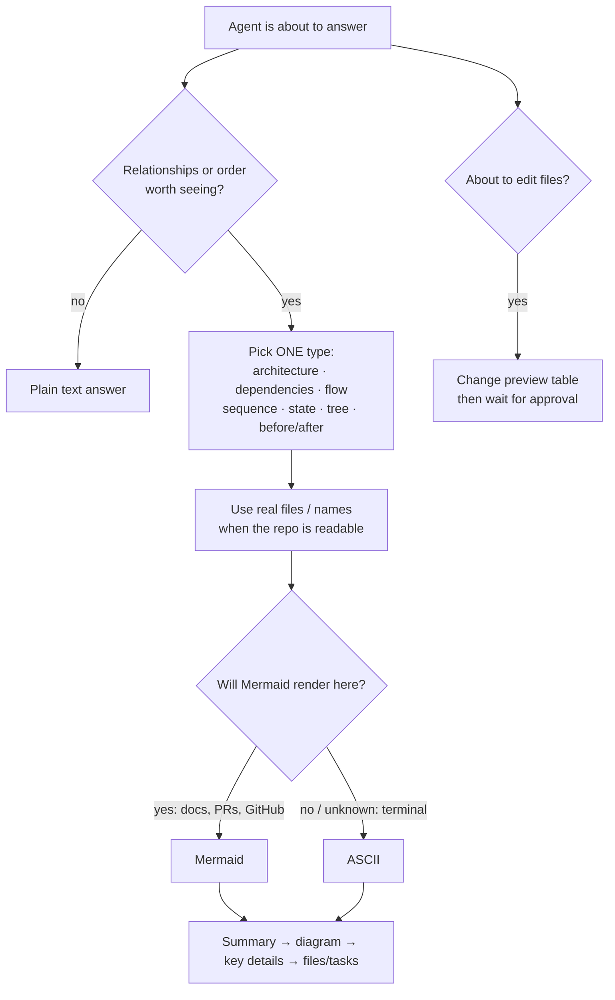

# Visual Explainer

**Turn complex AI coding-agent responses into diagrams, flows, trees, and architecture maps.**

A portable skill/plugin that helps AI coding agents communicate complex technical information visually. When an answer is about *what connects to what* or *what happens next*, the agent replies with one small diagram plus the few lines of text that matter, instead of paragraphs you have to turn into a mental model yourself.

It is one [Agent Skill](https://agentskills.io/specification) packaged as an [Agent Plugin](https://agent-plugins.org/specification) and a [Claude Code plugin](https://code.claude.com/docs/en/plugins/overview). It is not an agent, an MCP server, a CLI or an npm package, and it doesn't need a renderer.

```
You: Explain what happens when the user logs in.

Agent (with Visual Explainer):
Login goes through our API, which trades the password for a Supabase session and sets a cookie.

Browser          API /auth/login       Supabase Auth       Postgres
   │ POST email+pw     │                     │                 │
   │──────────────────▶│ signInWithPassword  │                 │
   │                   │────────────────────▶│                 │
   │                   │◀──── session ───────│                 │
   │                   │ upsert profile ─────────────────────▶ │
   │◀─ Set-Cookie 200 ─│                     │                 │

Bad credentials: Supabase returns 400, which the API turns into a 401.
```

## How it works



The rules live in one file, [`skills/visual-explainer/SKILL.md`](skills/visual-explainer/SKILL.md) (about 1.5k tokens, loaded only when relevant). Templates for each diagram type are in [`references/`](skills/visual-explainer/references/). The agent reads only the one it needs.

### Why ASCII in terminals?

Mermaid is the better format when it gets rendered, and the worse one when you see raw source. Terminal agents (Claude Code CLI, Codex CLI, OpenCode, Pi) print Mermaid as code. So the skill uses **Mermaid** for anything rendered (Markdown files it writes, PR descriptions, GitHub, IDE previews, or when you ask for it) and **ASCII** for inline terminal replies or when it can't tell. Override it any time with "always use Mermaid" or "ASCII only", or permanently with the [always-on snippet](adapters/always-on.md).

## Install

The same `skills/visual-explainer` folder is used everywhere. Only the wrapper differs.

### Claude Code

```bash
# from GitHub
/plugin marketplace add rajeevrajchal/claude-plugin-visual-explainer
/plugin install visual-explainer@visual-explainer

# or from a local checkout, for one session
git clone https://github.com/rajeevrajchal/claude-plugin-visual-explainer
claude --plugin-dir ./claude-plugin-visual-explainer
```

Commands: `/visual-explainer:visualize`, `:architecture`, `:flow`, `:sequence`, `:state`, `:dependencies`, `:preview`, each taking an optional subject. The skill also triggers on its own when an answer calls for it.

### claude.ai and Cowork

Zip the folder (or add the GitHub repo as a marketplace) and go to **Customize → Plugins → Add → Upload plugin**. The skill loads in chat and Cowork. In Cowork the commands run as `/visual-explainer:<command>`. In chat they load as skills that Claude applies when relevant. All skill frontmatter uses only Agent Skills spec fields, so uploads aren't rejected.

### Codex, VS Code / Copilot, Cursor, OpenHands, Kiro (Agent Plugins clients)

These load the portable [`plugin.json`](plugin.json) + `skills/` layout directly. Install the folder with your client's plugin installer. For skill-only use in Codex:

```bash
mkdir -p ~/.agents/skills
ln -s /path/to/claude-plugin-visual-explainer/skills/visual-explainer ~/.agents/skills/visual-explainer
```

Invoke explicitly with `$visual-explainer architecture <subject>`, or let Codex pick it up automatically.

### OpenCode

OpenCode reads `~/.agents/skills/`, so the symlink above is enough for the skill. For the slash commands, link the command files. They are plain Markdown with `description` and `$ARGUMENTS`, which OpenCode understands:

```bash
mkdir -p ~/.config/opencode/commands
ln -s /path/to/claude-plugin-visual-explainer/commands/*.md ~/.config/opencode/commands/
```

Then use `/architecture`, `/flow` and so on. If your OpenCode version uses a singular `command/` directory, link into that instead.

### Pi

Pi also reads `~/.agents/skills/`. Use the same symlink and invoke with `/skill:visual-explainer architecture <subject>`.

### Anything else

Copy `skills/visual-explainer/` wherever your agent loads Agent Skills from. If it has no skill support, paste the body of `SKILL.md` into its instructions file and keep `references/` next to it.

> Don't install the skill twice in the same agent (e.g. the Claude Code plugin **and** a copy in `~/.claude/skills`), or it will be listed twice.

## Commands

| Command        | Diagram                                              |
|----------------|------------------------------------------------------|
| `visualize`    | Picks the type itself                                |
| `architecture` | Components and what talks to what                    |
| `flow`         | Workflow, implementation plan, user journey          |
| `sequence`     | Who sends what to whom, in order                     |
| `state`        | States and the events between them                   |
| `dependencies` | File/module imports, built from the real code        |
| `preview`      | Table of files and code a change will touch, then waits for approval |

Each command is a few lines that hand a forced diagram type to the same skill ([`commands/`](commands/)). Agents without commands get the same behaviour by asking ("diagram the dependencies in src/").

## Rules the skill follows

1. Visualize relationships, not paragraphs. Simple questions get plain text.
2. One useful diagram, not five small ones. Keep it to about 12 nodes.
3. Use real file and module names when the repo is readable. Read the code first.
4. Never invent edges. Mark planned or uncertain parts as dashed or `?`.
5. The diagram replaces explanation. No edge-by-edge walkthrough afterwards.
6. Mermaid where it renders, ASCII where it doesn't.
7. Only diagram what the agent would say out loud (plans, files, tool results, progress it actually tracked), never private reasoning.
8. Before editing files, show a change preview (intent, file table, risk) and wait for the user to accept.

## Layout

```
claude-plugin-visual-explainer/
├── plugin.json                    # Agent Plugins v1 manifest (portable)
├── .claude-plugin/
│   ├── plugin.json                # Claude Code / claude.ai / Cowork manifest
│   └── marketplace.json           # lets the repo be added as a marketplace
├── skills/visual-explainer/       # ← the core; everything else is a wrapper
│   ├── SKILL.md
│   └── references/                # one template file per diagram type
├── commands/                      # thin slash-command wrappers (Claude Code, Cowork, OpenCode)
└── adapters/always-on.md          # optional AGENTS.md / CLAUDE.md snippet
```

No hooks. Triggering is handled by the skill description, and a hook would add context or latency to every session for no gain.

## Testing

The eval suite (nine scenarios, each run with and without the plugin) is not included in this folder. The results below are from that suite and predate the change preview, which is not yet covered by an eval.

### Latest results

Claude Code 2.1.287, 2 runs per arm, 2026-10-02. Score = share of graders passed. The "skill fired" check isn't scored, so the baseline isn't penalised for lacking it.

| Scenario | With plugin | Without | Δ |
|---|---|---|---|
| 1 Simple question → no diagram | 1.00 | 1.00 | 0.00 |
| 2 Architecture | 1.00 | 0.75 | +0.25 |
| 3 Implementation plan | 1.00 | 0.00 | +1.00 |
| 4 Login sequence | 0.50 | 0.25 | +0.25 |
| 5 Auth states | 1.00 | 1.00 | 0.00 |
| 6 Refactor → before/after | 1.00 | 0.25 | +0.75 |
| 7 Repo structure | 1.00 | 1.00 | 0.00 |
| 8 Dependencies (real imports + cycle) | 1.00 | 0.83 | +0.17 |
| 9 Long plan → compressed | 0.83 | 0.00 | +0.83 |
| **Mean** | **0.93** | **0.56** | **+0.36** |

The biggest gains are where the model doesn't draw on its own: plans, refactors and summarising long output. Where it already draws well (state machines, repo trees) the skill doesn't hurt. The scenario 4 miss was a run where Claude explored the empty sandbox first and then answered without loading the skill.

## Limits

- Automatic use depends on the host choosing to load the skill from its description. In the final eval run it triggered in 14 of 16 eligible runs. It can be missed when the agent goes exploring files first and then answers. If that matters to you, use a command (deterministic) or add the [always-on snippet](adapters/always-on.md).
- Whether Mermaid renders depends on the client. The skill can't detect that reliably, so it falls back to ASCII when unsure.

## Privacy

The plugin is Markdown instructions only. It runs no code, has no hooks or MCP servers, and collects, stores and sends no data.

## License

MIT
