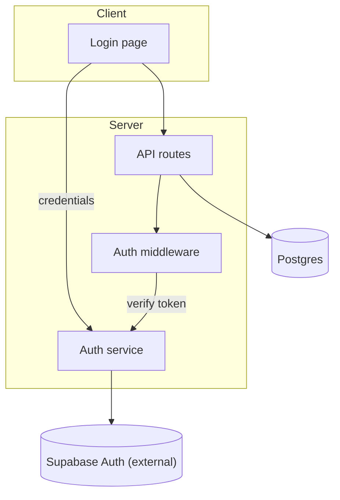
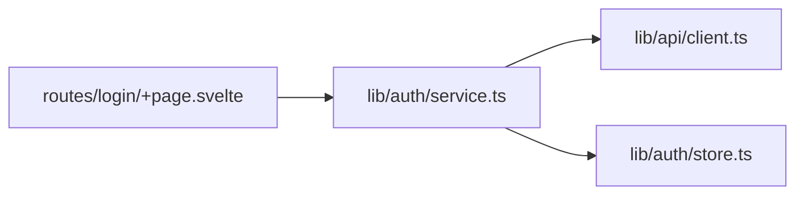

# Architecture graph

Answers: **what are the parts, and what talks to what?**

Use for: how frontend/API/services/storage fit together, where a new component sits, the boundaries of a feature.

## Rules

- Direction: `TD` for layered systems (UI on top, storage at the bottom), `LR` for pipelines.
- Group by boundary (client / server / external) with `subgraph` only when there are 2+ boundaries. Don't nest subgraphs.
- Edges point in the direction of the call or request. Label them only when the verb matters.
- External services (Supabase, Stripe, S3) are their own nodes, labelled as external.
- If the user's request adds something, mark new nodes `NEW` and new edges dashed.

## Mermaid



With real files (codebase available):



## ASCII

```
 Client                 Server                         External
 ──────                 ──────                         ────────
 Login page ──creds──▶  Auth service ───────────────▶ Supabase Auth
     │                       ▲
     ▼                       │ verify token
 API routes ──▶ Auth middleware
     │
     ▼
 Postgres
```

Keep ASCII boxes optional. Plain labels plus `──▶ │ ▼ ▲` arrows read faster than drawn boxes.
