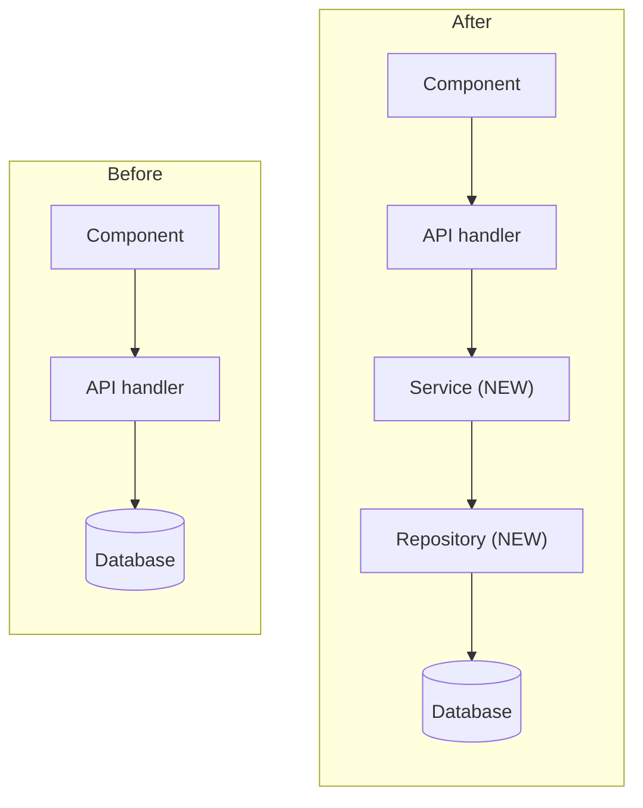

# Before / after

Answers: **what changes structurally?**

Use for refactors, migrations, introducing a layer, splitting or merging services, replacing a dependency.

## Rules

- Keep the same node names and layout on both sides, so only the change stands out.
- Mark the difference in words: `NEW`, `REMOVED`, `MOVED`, and say what changed on each edge.
- Show only the part of the system that changes, plus one node of context on each side.
- After the pair, write one line on why the change is worth it and one on the main risk.

## Mermaid (one block, two subgraphs)



## ASCII

```
BEFORE                       AFTER
Component                    Component
   │                            │
   ▼                            ▼
API handler                  API handler
   │  (SQL inline)              │
   ▼                            ▼
Database                     Service        ← NEW: business rules
                                │
                                ▼
                             Repository     ← NEW: all SQL lives here
                                │
                                ▼
                             Database
```
