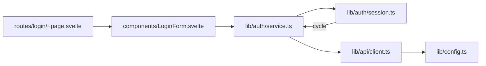

# Dependency graph

Answers: **what depends on what?** (files, modules, packages, services)

## Rules

- Build it from the code, not from memory. Every edge must match an import/require/call you actually saw. Check:
  - relative **and** alias imports (`../x`, `$lib/x`, `@/x`, `~/x`)
  - `<script>` blocks in `.svelte` / `.vue` / `.astro` files
  - re-exports (`export * from`) and dynamic `import()`
- Before writing "X imports nothing", grep X for `import`/`require` once more. A wrong "no dependencies" claim is as bad as an invented edge.
- If you only read part of the code, say which part.
- `A → B` means A imports/depends on B.
- Collapse leaves that don't matter (`3 UI components`) so that you stay within about 12 nodes.
- Call out what the user cares about: cycles, a module many things depend on, or modules a change will ripple into.
- Label nodes with the path relative to the source root.

## Mermaid



## ASCII: use an adjacency list

Drawn arrows go wrong as soon as edges cross. For dependency graphs, list them:

```
routes/login/+page.svelte    → components/LoginForm.svelte
components/LoginForm.svelte  → lib/auth/service.ts
lib/auth/service.ts          → lib/api/client.ts, lib/auth/session.ts
lib/auth/session.ts          → lib/auth/service.ts        ⟲ cycle
lib/api/client.ts            → lib/config.ts
lib/config.ts                → (none)
```

A short chain with no branches can still be drawn: `a.ts ──▶ b.ts ──▶ c.ts`.

Then one line for the finding, e.g. "`session.ts` imports back into `service.ts`. That cycle is why the mock breaks in tests."
