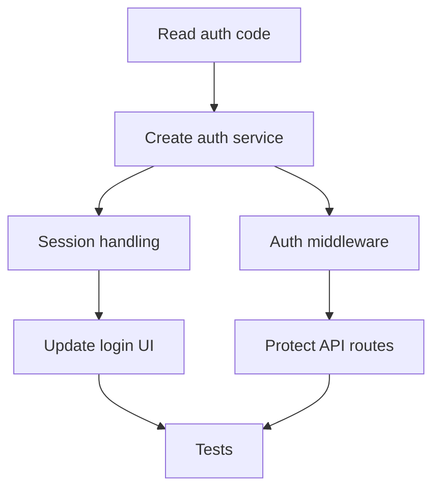
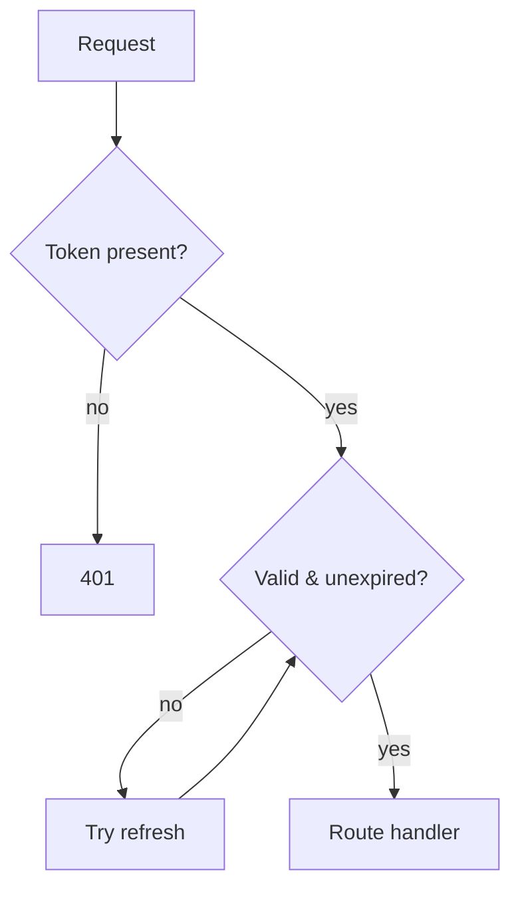
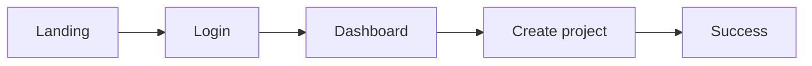

# Flowchart: workflows, plans, journeys, progress

Answers: **what happens next?**

## When a flowchart beats a numbered list

Only when there is branching, a loop, parallel work, or tasks that depend on more than one previous task. A straight line of 4 steps is clearer as a numbered list, so use the list.

## Implementation plan with task dependencies

Edges mean "must finish before". Parallel tasks fan out.



ASCII:

```
Read auth code
      │
      ▼
Create auth service
      │
  ┌───┴──────────────┐
  ▼                  ▼
Session handling   Auth middleware
  │                  │
  ▼                  ▼
Update login UI    Protect API routes
  └───────┬──────────┘
          ▼
        Tests
```

After the diagram, list the tasks once, as a numbered list with file paths, only if the user will act on them.

## Process with decisions



## User journey



## Progress (only from real task state)

```
✓ Analyze   ✓ Plan   ✓ Implement   ● Test   ○ Complete
```

Use the agent's own task list or tool results. Never infer or estimate progress.
