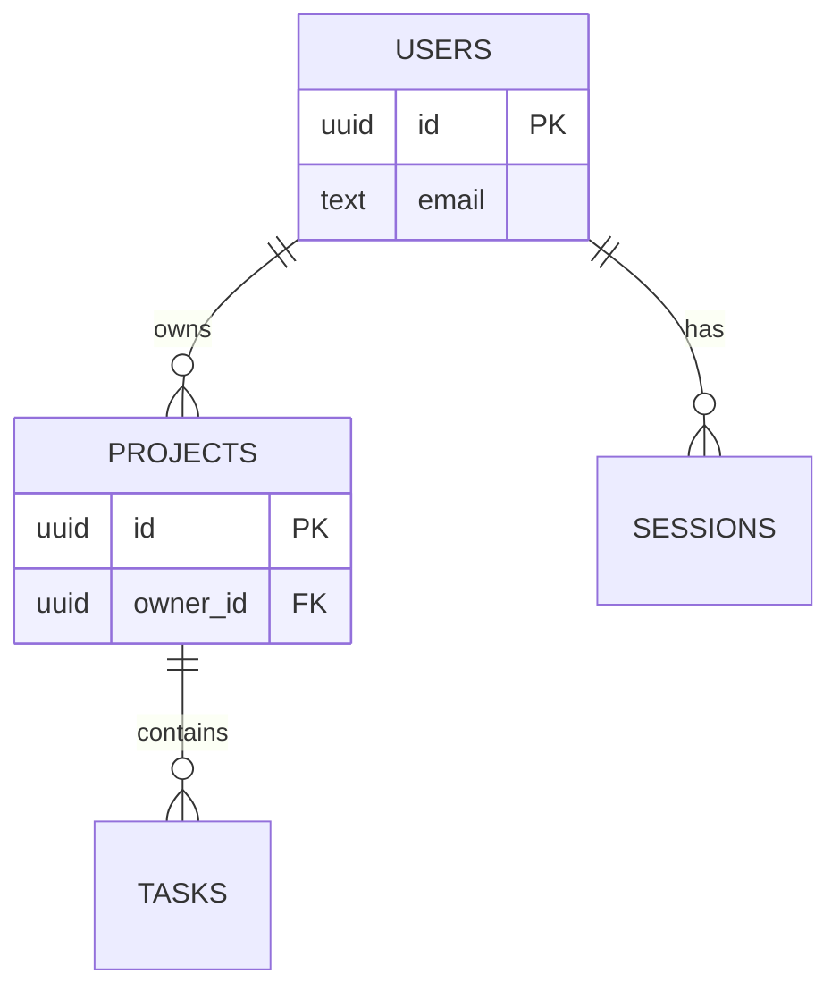
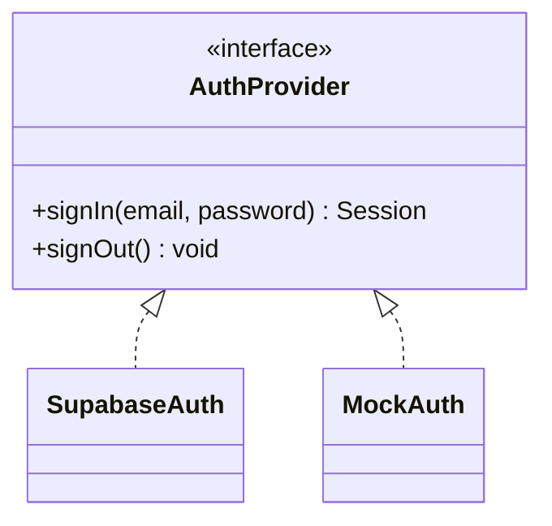
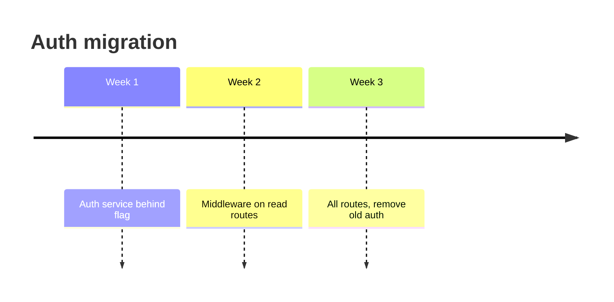
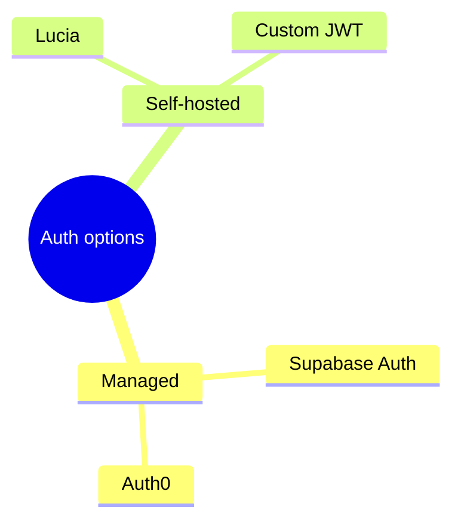

# Other Mermaid types (use sparingly)

Use one of these only when the content really is this shape. When in doubt, a flowchart or a table is clearer.

## ER diagram: data model / schema relationships

Build it from the actual schema or migrations when available. Show keys and relationships, not every column.

## Class diagram: type/interface relationships in OO code

## Timeline: release or migration phases with dates

## Mindmap: breaking down an open question or option space

ASCII fallback for all of these is an indented list or a two-column table. Don't try to draw them as ASCII art.
