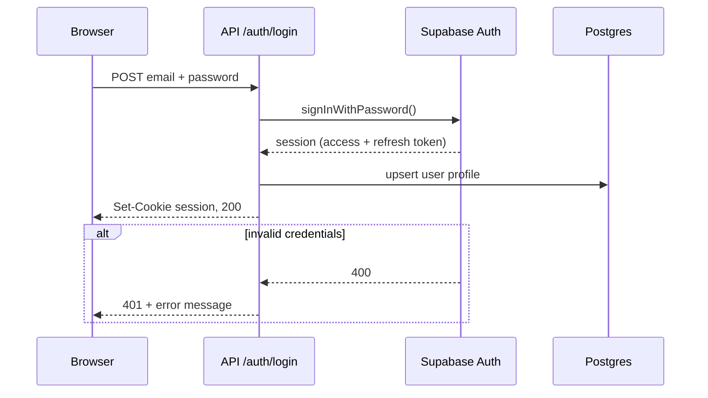

# Sequence diagram

Answers: **who sends what to whom, in what order?**

Use when order matters and 2+ actors exchange messages: login, OAuth, payments, webhooks, cache-then-DB reads, job queues. If the order doesn't matter, use an architecture graph instead.

## Rules

- 3–6 participants. Order them left→right in the order they first act.
- Request arrows `->>`, responses `-->>`. Use `alt`/`opt` for the one failure path that matters, not every error.
- Messages say what crosses the wire (`POST /login {email, pw}`, `JWT`), not prose.
- Use real route and function names when the code is available.

## Mermaid



## ASCII

```
Browser          API /auth/login       Supabase Auth       Postgres
   │ POST email+pw     │                     │                 │
   │──────────────────▶│ signInWithPassword  │                 │
   │                   │────────────────────▶│                 │
   │                   │◀──── session ───────│                 │
   │                   │ upsert profile      │                 │
   │                   │──────────────────────────────────────▶│
   │◀─ Set-Cookie 200 ─│                     │                 │
   │                   │                     │                 │
   │  (bad creds: Supabase 400 → API 401 to browser)           │
```
