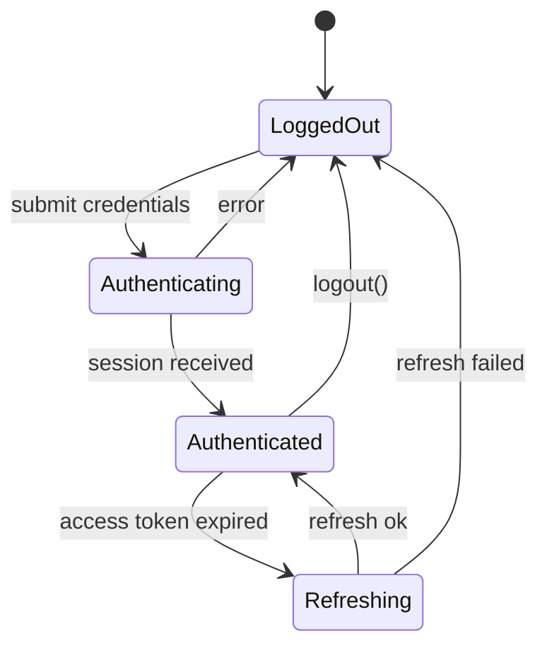

# State diagram

Answers: **what states can this be in, and what moves it between them?**

Use for auth/session lifecycles, request/loading states in UI stores, order or job status, connection state, feature flags with modes.

## Rules

- 3–8 states. Name each one after its condition (`Authenticated`), not after an action.
- Label each transition with the event that triggers it (`token expired`, `logout()`).
- Include the error/expired path. That's usually why someone asked.
- If the code defines the states (an enum, a union type, a store), use exactly those names and mention the file.

## Mermaid



## ASCII

Loops and back-edges make drawn ASCII state machines unreadable, so use the happy path plus a transition table:

```
LoggedOut ──▶ Authenticating ──▶ Authenticated ⇄ Refreshing
```

```
LoggedOut       ──submit──────────▶ Authenticating
Authenticating  ──session─────────▶ Authenticated
Authenticating  ──error───────────▶ LoggedOut
Authenticated   ──token expired───▶ Refreshing
Refreshing      ──ok──────────────▶ Authenticated
Refreshing      ──failed──────────▶ LoggedOut
Authenticated   ──logout()────────▶ LoggedOut
```
